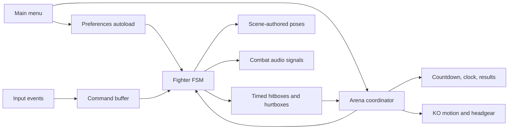
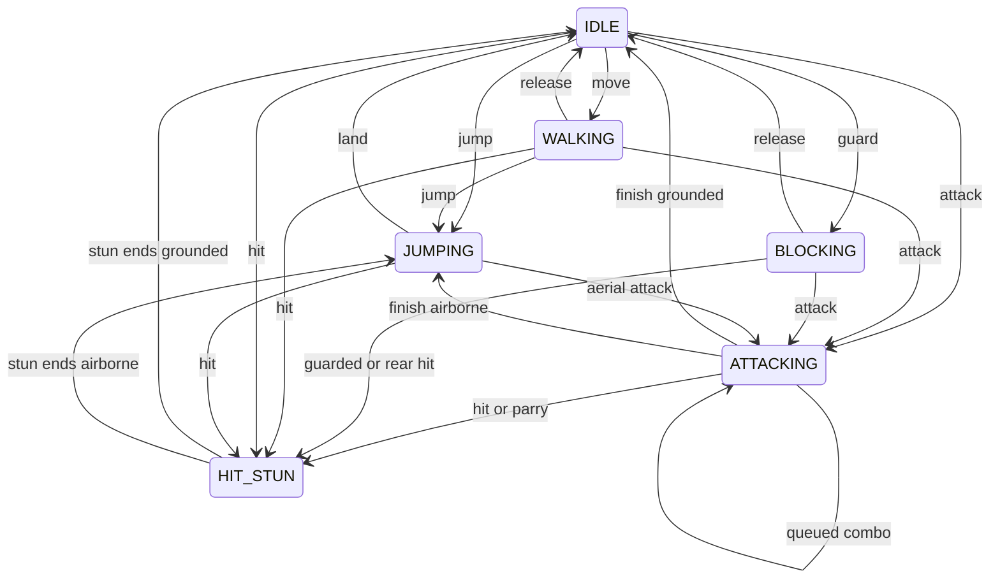

# Architecture and validation for this project

## System flow

The arena owns deterministic match progression. Fighters own state and movement. Presentation reads gameplay; it does not apply damage. Preferences survives scene changes and initializes bus gains. Clouds run independent visual movement.

## Fighter state machine

| State | Behavior | Exit |
| --- | --- | --- |
| IDLE | Can move, jump, attack, or guard | Relevant input or hit |
| WALKING | Ground movement with automatic facing | Release/change input or hit |
| JUMPING | Gravity, air steering, optional attack | Landing, attack, or hit |
| ATTACKING | Startup/active/recovery, movement, buffered combo | Chain, finish, hit, or parry |
| BLOCKING | Ground shield movement; front guard protects | Release, jump, attack, or hit |
| HIT_STUN | Controls locked; knockback/gravity continue | Stun expiry to idle/jumping |

Jump and attack can begin together. Attack beats held guard. Every successful front block parries; there is no precision-timed parry window. Guard stun is represented by HIT_STUN plus guard_hit. State transitions remove leaving attack hitboxes.

This diagram summarizes principal transitions; BLOCKING can also jump directly. No asynchronous animation completion determines damage timing.

## Timing domains

- Physics is fixed at 60 Hz. Live match/countdown/stun counters use physics ticks.
- Attacks advance fractional state_frame by ATTACK_SPEED (1.25). Hitbox thresholds are crossed rather than compared only for exact equality.
- Buffers use accumulated simulation delta and per-command lifetime.
- Cinematic duration uses normal delta; movement/poses/headgear use delta × slow factor.
- Clouds and audio remain unscaled. No global time-scale change is applied.

## Match phases

Home → chosen mode → 0.5-second start cue transition → 3-second countdown → live 60-second match.

Timeout freezes combat and shows a result immediately. A knockout freezes new combat and begins a 1.4-second slow presentation; result/audio follows. Double KOs animate both defeated fighters and produce a draw. The weapon and shield always fly; headgear flies only when equipped. Restart clears cinematic props, restores fighters/headgear, resets audio, and repeats the countdown. Return to menu destroys the arena scene and stops its audio.

Winner is determined from remaining health. Health values are not printed on the result panel. Current edge case: if KO and timer expiry occur in the same simulation tick, the KO cinematic still runs but the result reason/audio uses TIME UP because the remaining clock is zero.

## Signals and callbacks

| Signal | Emission | Connection/use |
| --- | --- | --- |
| Fighter.combat_sound(event: StringName) | Active sword frame, jump launch, hit/guard resolution | Arena connects to MatchAudio.on_combat_sound |
| AudioStreamPlayer.finished | Announcer finishes | MatchAudio.play_next_voice |
| Button.pressed | Menu/result buttons | Navigation, start, reset, or exit handlers |
| OptionButton.item_selected | Difficulty/body/weapon/hat selection | Saved preference and preview handlers |
| Range.value_changed | Settings sliders | Bus gain + preference save |
| SceneTree.physics_frame | Engine physics boundary | Awaited by tests for input timing |
| SceneTreeTimer.timeout | Timed delay | Menu transition and test cleanup |

`_ready`, `_input`, `_physics_process`, `_draw`, `_unhandled_key_input`, and `_exit_tree` are engine callbacks, not signals. Area2D.area_entered is not connected; immediate rectangle intersection resolves attacks. KO audio is triggered directly by Arena, not a separate custom signal.

## Persistence and configuration precedence

Project configuration selects main_menu.tscn, registers Preferences, and chooses viewport/renderer. GameSettings supplies shared defaults/catalogs/keys. Explicit scene exports override their script defaults. Saved choices then replace character/weapon/hat textures at runtime, without changing their authored transforms. Menu sliders multiply base player gains through audio buses. Preferences saves outside the repository in user://settings.cfg.

## Testing strategy

Nine existing headless suites exercise mechanics, scene resources, UI navigation, persistence, sound routing, and cinematic transitions. See README for commands and coverage. Menu tests use an isolated preferences path and restore options. Audio tests give the mixer time to release stopped playback. Pass/fail is printed and assertion failures return nonzero.

Do a desktop pass after meaningful visual/audio changes: both play modes, each difficulty, both facing directions, all body/weapon/hat choices, aerial attacks, shield/parry, wall knockback, KO/timeout/double KO, rematch, menu return, and volume mute/unmute. Verify titles/icons/text remain visible at the stretched viewport size and listen to track loop boundaries.

## Limitations and extension points

Local keyboard only; no networking/gamepad rebinding. One mathematical floor and arena; no platforms. One melee chain shared by all weapon art. Hats are cosmetic. AI is rule-based. No authored sprite animation sheets, timed parry window, hit-stop, music crossfade, or projectile weapons. Preferences clamps normal numeric ranges but does not fully validate malformed type data or surface save errors in the menu.

Add new attacks through data plus tests; add actual weapon abilities through gameplay, not catalog textures alone. Add platforms by redesigning movement/collision deliberately. Preserve named rig/UI nodes referenced in code. Academic evaluation should distinguish implemented systems, tested behavior, and proposed future work.

The final-blow cinematic detaches the weapon and shield as well as optional headgear. spawn_flying_equipment() preserves each source sprite's global transform, hides the original, and assigns an independent arc/spin. Weapon launch is 260 horizontally / 360 upward with spin 8; shield launch is 160 horizontally / 300 upward with opposite spin 6; headgear uses 220 / 420 with spin 5. These are pixels/second and radians/second, scaled by cinematic delta. All share prop gravity 900. Fighter.equipment_detached prevents pose updates from showing hand equipment again; reset/clear restores it. Loose props are cosmetic and have no collision/damage.
